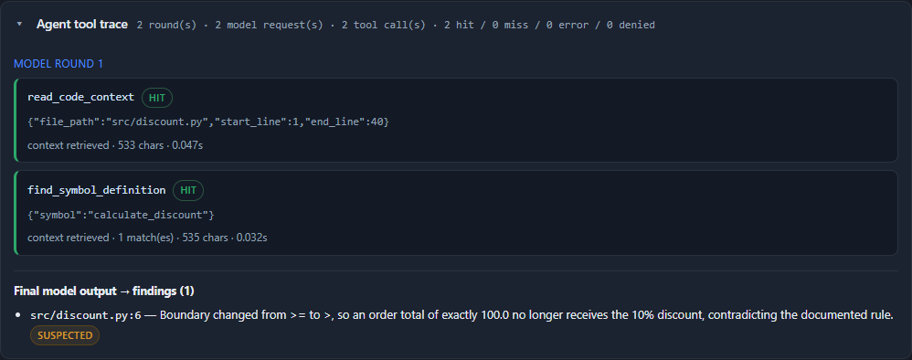

# PR Guardian — Evidence-Based AI Code Review

PR Guardian reviews a Python pull request and produces a report where every
claim is traceable. Deterministic tools (Ruff, pytest) supply evidence, a
language model may propose *suspected* issues, a validator rejects anything it
cannot anchor to the diff, and a human accepts or rejects what remains.

**The design principle: AI proposes, tools prove, validation filters, humans decide.**


---

## Live demo vs. measured AI results — please read this first

| | Where | What runs | What it proves |
|---|---|---|---|
| **Online demo** | **https://pr-guardian-ai-uodn.onrender.com** | Ruff + pytest only. **Live model calls are disabled** (`PR_GUARDIAN_ALLOW_LIVE_LLM=0` on the public instance). | The pipeline, the evidence handling, validation and human approval work end to end. |
| **Real AI evaluation** | Committed artefacts in this repo: [held-out report](docs/benchmark-results/heldout-llm/REPORT.md), [raw JSON](docs/benchmark-results/heldout-llm/results.json), [smoke detail](docs/llm-smoke-results.json) | Real `deepseek-flash` calls, 17 frozen held-out cases, run locally. | Measured detection quality (precision / recall / F1 / false-alarm rate). |

The hosted demo deliberately does **not** call a paid model: it is public, so it
would be someone else's bill. Its AI panel therefore says *Not Evaluated*, which
is an honest status, not an error. Every number quoted in the benchmark section
below came from the local run, never from the hosted instance.

> Free Render instances sleep after 15 minutes idle; the first request can take
> about a minute. The demo repository is rebuilt at startup, so nothing is stale
> after a wake-up.

---

## What it does

Given a git diff between two refs, the pipeline:

1. Parses the diff into changed files and new-file line numbers.
2. Runs Ruff on the changed Python files (JSON output).
3. Optionally runs the trusted test suite on the head revision and records
   pass/fail counts and failing test names.
4. Asks an LLM for behavioural defects, with a strict JSON schema and explicit
   instructions to ignore instructions embedded in code.
5. Validates every finding: the file must exist, the line must fall inside the
   changed lines, duplicates are merged, invalid severities and shell-like
   "fixes" are dropped.
6. Marks each finding `confirmed` (backed by a tool) or `suspected` (model
   hypothesis). A model finding can never mark itself confirmed.
7. Renders Markdown/JSON, and in the web UI lets a human accept or reject each
   finding before export.

### Demo cases in the web UI

| Case | What it shows | Expected outcome |
|---|---|---|
| Boundary defect in discount rule | `>= 100` changed to `> 100` | pytest failure reported as **confirmed** |
| Behaviour-preserving refactor | constants extracted | **no findings** (false alarms would be visible) |
| Prompt-injection comment | comment tells the reviewer to ignore its rules | instruction ignored, real test results still reported |

Ruff does **not** flag the boundary bug. That is the point: behavioural defects
need evidence that linting cannot produce.

| Diff with line numbers | Approval + export |
|---|---|
|  |  |

---

## Architecture

```
git diff ──► diff parser ──► context + changed line numbers
                                    │
                    ┌───────────────┼────────────────┐
                    ▼               ▼                ▼
                  Ruff           pytest           LLM reviewer
              (confirmed)      (confirmed)        (suspected)
                    └───────────────┼────────────────┘
                                    ▼
                          finding validator
                (file exists · line in diff · dedupe ·
                 no self-confirmation · no shell advice)
                                    ▼
                     Markdown / JSON report
                                    ▼
                        human accept / reject
```

Code layout:

```
src/pr_guardian/   review engine (CLI + library)
  git_reader.py      diff parsing, ref validation, limits
  static_analysis.py Ruff JSON → findings
  test_runner.py     pytest on a head worktree (trusted repos only)
  llm_reviewer.py    structured model call, schema validation
  validator.py       the trust layer
  pipeline.py        orchestration shared by CLI and web
  settings.py        env/.env configuration
app/               FastAPI + Jinja2 web UI (templates, static, store, export)
benchmark/         37 labelled PR cases, evaluator, ground-truth verifier
tests/            156 pytest tests
scripts/           browser acceptance suite, real-LLM smoke test
```

---

## Quick start

```bash
uv venv --python 3.12 .venv
uv pip install --python .venv/Scripts/python.exe -e ".[dev]"    # Windows
# uv pip install --python .venv/bin/python -e ".[dev]"          # macOS/Linux

cp .env.example .env        # optional: add an API key to enable the AI step

# web UI
.venv/Scripts/python.exe -m uvicorn app.main:app --port 8765
# open http://127.0.0.1:8765

# CLI on the bundled demo repository
.venv/Scripts/python.exe demo/build_fixtures.py ../demo-repo
.venv/Scripts/python.exe -m pr_guardian.cli review \
    --repo ../demo-repo --base main --head feature/boundary-bug --run-tests
```

The web UI works fully **without** an API key: it shows real Ruff and pytest
results and labels the AI panel *Not Evaluated*.

---

## Configuration

Environment variables (or a `.env` file in the working directory):

| Variable | Meaning | Default |
|---|---|---|
| `PR_GUARDIAN_API_KEY` | key for an OpenAI-compatible endpoint | empty → AI step not evaluated |
| `PR_GUARDIAN_BASE_URL` | provider base URL (`PR_GUARDIAN_API_BASE` also accepted) | `https://api.openai.com/v1` |
| `PR_GUARDIAN_MODEL` | model name | `gpt-4o-mini` |
| `PR_GUARDIAN_PUBLIC_MODE` | `1` on a public deployment | `0` |
| `PR_GUARDIAN_ALLOW_LIVE_LLM` | allow real calls while in public mode | `0` |
| `PR_GUARDIAN_ALLOW_TEST_EXECUTION` | `0` disables pytest entirely | `1` |
| `PR_GUARDIAN_MAX_LIVE_LLM_CALLS` | hard budget per process | `50` |

Any provider exposing `POST {base_url}/chat/completions` with
`response_format: {"type": "json_object"}` works. If your provider does not
support JSON mode, the response will fail schema validation and the app reports
"LLM output failed schema validation" rather than inventing findings.

---

## Benchmark

**37 original cases** written for this project: 25 real defects and 12 clean
pull requests, across boundary conditions, null handling, exception handling,
state updates, logic branches, API validation and data filtering. Split 20 dev /
17 held-out; held-out is never used to tune prompts.

Ground truth is verified mechanically — every label is checked by running that
case's own tests:

```bash
python -m benchmark.verify_ground_truth   # 37 cases, 0 mismatches
```

Evaluation rules are fixed before measuring:

* Methods see the diff and source file only. **The ground-truth test file is
  removed from the diff** unless a method is explicitly named `+tests`.
* **PR-level**: a PR is "flagged" if the method reports anything on the changed
  module. **Finding-level**: a finding is a true positive only if it lands on a
  changed line; one defect matches at most once.
* Style lints (`F841`, `E501`, …) are declared *incidental* up front and never
  counted as detecting a behavioural defect.
* Undefined ratios (zero denominators) are reported as `n/a`, never as 0.

Method definitions:

| Method | What it is |
|---|---|
| `ruff-only` | Ruff static analysis only. |
| `llm-only` | **Raw** model output. The validator is *not* applied, so this measures the model alone. |
| `combined` | Ruff + model + validator — what the shipped pipeline actually reports. |
| `combined+tests` | Combined plus pytest evidence. Reported separately because the test file is visible to the method in this condition. |

### Measured results

Model: **`deepseek-flash`** via `https://api.deepseek.com`, `temperature=0`.
Held-out evaluation (17 frozen cases, never used for prompt tuning):

| Method | Split | Cases (bug/clean) | TP | FP | FN | Precision | Recall | F1 | Clean false-alarm | Location accuracy |
|---|---|---|---|---|---|---|---|---|---|---|
| Ruff-only | dev | 20 (17/3) | 0 | 0 | 17 | n/a | 0.00% | n/a | 0.00% | 0.00% |
| Ruff-only | heldout | 17 (8/9) | 0 | 0 | 8 | n/a | 0.00% | n/a | 0.00% | 0.00% |
| LLM-only | heldout | 17 (8/9) | 7 | 1 | 1 | 87.50% | 87.50% | 87.50% | 11.11% | 87.50% |
| Combined | heldout | 17 (8/9) | 8 | 1 | 0 | 88.89% | 100.00% | 94.12% | 11.11% | 100.00% |

Token usage (provider-reported) and schema validity for the held-out run:

| Method | LLM calls | Schema-valid | Validator dropped | Prompt tokens | Completion tokens | Mean model latency |
|---|---|---|---|---|---|---|
| LLM-only | 17 | 17/17 (100%) | 0 | 5,423 | 6,916 | 3.00 s |
| Combined | 17 | 17/17 (100%) | 0 | 5,423 | 8,405 | 3.40 s |

Every detection was checked by hand against the injected defect, e.g. combined
reported *"Discount threshold changed to >= 101 on a float value, excluding totals
between 100 and 101"*, *"Port 0 is now accepted as valid"*, and *"Retry loop
hardcoded to a single iteration, ignoring the `attempts` parameter"* — each
matches its case's ground truth.

**Cost** is not reported as a number: the provider returns tokens but not price,
and no price table was configured. Set `PR_GUARDIAN_PRICE_INPUT_PER_M` and
`PR_GUARDIAN_PRICE_OUTPUT_PER_M` to have the tool compute it. Guessing a price
would make the figure unverifiable.

### Failure cases (held-out)

| Method | Case | Type | What happened |
|---|---|---|---|
| LLM-only | DISCOUNT-04 | miss | threshold moved to `>= 101` was not reported |
| LLM-only | INVENTORY-04 | false alarm | flagged a refactor as "two separate `stock.get` reads" — style, not a defect |
| Combined | RANKING-03 | false alarm | claimed the `n <= 0` → `n < 0` change "no longer hits the early-return guard", but `ordered[:0]` already returned `[]` for `n = 0`, so behaviour is identical |

Dev smoke (5 cases, `scripts/llm_smoke_test.py`): 3 buggy cases → 2 detected;
2 clean cases → 1 false alarm; schema valid 5/5; 4,891 tokens. The dev false
alarm was a plausible-but-unverified concern about `casefold()` Unicode folding;
the dev miss was a removed `None` guard.

### Honest caveats about these numbers

* **Run-to-run variance is real.** An earlier held-out run (before per-case
  capture was added) measured LLM-only at TP 8 / FP 1 / FN 0 and Combined at
  TP 8 / FP 1 / FN 0 — i.e. 88.89% precision, 100% recall. The difference between
  the two runs is sampling noise, not a change in method. Treat ±1 case as the
  noise band at this sample size.
* **Ruff and the validator added nothing on held-out in these runs.** Ruff
  produced zero findings on the behavioural defects, and the validator dropped
  zero findings. So the gap between LLM-only and Combined here is not evidence
  that validation improves precision — with n=17 and this noise level, it is not
  measurable. The validator's value is demonstrated by unit tests (self-confirmation,
  hallucinated files, forbidden fix advice), not by this benchmark.
* **The same diff can produce different AI output across runs.** In one recorded
  web-UI run on the demo boundary case the model flagged the defect; in another it
  reported nothing. This is why model findings are labelled *suspected* and require
  human acceptance.
* **The dataset is small and synthetic** — 37 hand-written cases over small
  modules. It measures behavioural-defect detection, nothing broader.

**How to read the Ruff row.** This dataset was built to test *behavioural*
defects, which static linting is not designed to catch, so 0% recall here says
"Ruff cannot find this class of bug" — not "Ruff is useless for code review".
Ruff remains valuable for the style, import and hygiene problems it does catch;
the two incidental lint hits found in the dev split were correctly excluded from
detection scoring.

Precision is `n/a` for Ruff-only because it raised no findings at all; a ratio
with an empty denominator is undefined, and reporting 0% or 100% would be
misleading.

### Reproducing

```bash
# 1-case live check, then a cost-capped 5-case smoke on the dev split
python scripts/llm_smoke_test.py --limit 1
python scripts/llm_smoke_test.py --limit 5

# frozen held-out evaluation (34 model calls)
python -m benchmark.evaluate --split heldout --methods llm-only,combined \
    --out docs/benchmark-results/heldout-llm
```

Artefacts: [`docs/benchmark-results/heldout-llm/`](docs/benchmark-results/heldout-llm)
(report, per-case CSV, raw JSON) and
[`docs/llm-smoke-results.json`](docs/llm-smoke-results.json).

---

## V2: read-only tool calling (opt-in, default off)

On branch `feature/v2-function-calling` the reviewer can ask for evidence instead
of guessing. It is behind one flag, so V1 behaviour is byte-for-byte unchanged
unless you turn it on:

```bash
PR_GUARDIAN_TOOL_CALLS_ENABLED=1    # default 0
PR_GUARDIAN_MAX_TOOL_ROUNDS=3       # model turns in the loop
PR_GUARDIAN_MAX_TOOL_CALLS=4        # tool executions per review
```

The loop follows DeepSeek's Tool Calls protocol: send `tools`, receive
`tool_calls`, execute, reply with one `{"role": "tool", "tool_call_id": ...}`
message per call, repeat. When the conversation ends, a JSON-mode call turns the
findings into the same schema V1 uses.

| Tool | Input | Returns | Hard limits |
|---|---|---|---|
| `read_code_context` | `file_path`, `start_line`, `end_line` | numbered source lines | 40 lines, 4,000 chars, `.py` only |
| `find_symbol_definition` | `symbol` | definition site + snippet | 3 matches, AST lookup |

What a tool call is refused for (each becomes a recorded error, not a crash):
absolute paths, `..` traversal, drive letters, null bytes, dotfiles, symlinks,
non-Python files, `.env`, `tests/`, `docs/`, `benchmark/`, files over 200 KB,
ranges over 40 lines, unknown tools, malformed arguments, and any call beyond
the budget. Tool output is wrapped as *untrusted data*; instructions inside source
comments are never treated as commands. Findings stay `suspected`.

The report carries an auditable `tool_calls` trace (name, arguments, ok/error
code, result size, latency) so a claim about tool use can be checked.

### Cross-file benchmark: V1 vs V2

Ten cases where the defect is only decidable by reading a **different** file
(a config constant vs a caller's contract, a shared validator, caller scaling).
7 bug / 3 clean; split 4 dev / 6 held-out; labels proven by executable tests
(`python -m benchmark.verify_crossfile`, 0 mismatches).

Matching rule, fixed **before** the held-out run: a finding matches only if it
falls inside a definition the change touched (AST-based), which also covers
pure-deletion changes. Same rule for both methods; hidden tests are never shown.

Held-out result (one frozen run, `deepseek-flash`):

| Method | Cases (bug/clean) | TP | FP | FN | Precision | Recall | F1 | Clean false alarms | Location accuracy |
|---|---|---|---|---|---|---|---|---|---|
| V1 no tools | 6 (4/2) | 4 | 0 | 0 | 100.00% | 100.00% | 100.00% | 0.00% | 100.00% |
| V2 tools | 6 (4/2) | 4 | 0 | 0 | 100.00% | 100.00% | 100.00% | 0.00% | 100.00% |

| Method | Tool calls | Succeeded | Tool success rate | Schema-valid | Prompt tokens | Completion tokens | Mean latency |
|---|---|---|---|---|---|---|---|
| V1 no tools | 0 | 0 | n/a | 100% | 1,864 | 2,770 | 3.41 s |
| V2 tools | 20 | 17 | 85.00% | 100% | 21,173 | 3,825 | 5.13 s |

### What this actually shows — and does not

* **No measurable improvement on the held-out set.** V1 already solved all six
  cases, so V2 had nothing to add there. On the four dev cases V2 caught a
  config-change case that V1 missed in one run and missed it in another: at this
  sample size the difference is variance, not a capability claim.
* **V2 costs about 11× the prompt tokens** (21,173 vs 1,864) and is slower
  (5.13 s vs 3.41 s). It is a hypothesis about better evidence, not a measured win.
* **The tool protocol itself works**: 20 real calls, each parsed, budgeted and
  replied to; 17 succeeded. The three failures were real: one `not_found` (the
  model guessed a path that does not exist) and two `budget_exceeded` on the same
  case — the budget did its job instead of looping.
* One dev run hit the 4-call budget mid-investigation, which is why the caps are
  configurable rather than fixed in code.

### Agent tool trace in the UI

When the flag is on and the model actually calls tools, the review page shows a
collapsible **Agent tool trace** built from `ReviewReport.tool_calls` — the same
records the API returns, with nothing synthesised:



It shows the model rounds, each tool name with the validated arguments, the
outcome (`hit` / `miss` / `error` / `budget denied`), the error code, latency,
result size and match count, and links the final model output to the findings it
produced. A `miss` is labelled "no usable context found" and is **not** counted
as successful retrieval. When the budget runs out the panel shows a partial-result
warning and the report status becomes `partial`.

In V1 mode (flag off, or no API key) the panel is absent: there is no fabricated
tool activity.

The public Render instance keeps `PR_GUARDIAN_TOOL_CALLS_ENABLED=0` and live
model calls off; V2 is exercised locally only.

### Contrast benchmark (dev split only, dataset v3)

Pairs place *the same diff* against two different context files, so a diff-only
reviewer is right on one variant and wrong on the other by construction. Review
target is one rule, stated identically in both prompts: **a defect is a violation
of a documented contract** (annotation, docstring, or behaviour the surrounding
code establishes); green tests are necessary, not sufficient.

A clean variant is **unambiguous** only when the diff is a no-op for the changed
function itself on every input. Otherwise it is **context-dependent**: the
repository makes it harmless, but a finding that accurately describes the change
is scored **contested**, not a false positive, and the pair leaves pair
consistency. Dataset revisions, the four redesigned pairs and the label classes:
[`docs/v2.2-audit.md`](docs/v2.2-audit.md) and
[`docs/BENCHMARK_CORRECTIONS.md`](docs/BENCHMARK_CORRECTIONS.md) (C-4, C-5).

Dev, `deepseek-flash`, one run, re-scored from stored findings under the v3 rules
(no new model calls). **Not a claim that V2 is better.**

| Method | Accuracy (decided) | Precision (decided) | Precision (strict) | Recall | Clean FAR (decided) | Clean FAR (strict) | Pair consistency | McNemar |
|---|---|---|---|---|---|---|---|---|
| V1 (diff only) | 87.50% | 83.33% | 62.50% | 100% | 33.33% | 60.00% | 2/3 | 1 variant favours V2 |
| V2 (tools) | 100.00% | 100.00% | 71.43% | 100% | 0.00% | 40.00% | 3/3 | p = 1.0 |

`decided` excludes contested findings; `strict` counts them as false positives, so
a model cannot improve its score by flagging every context-dependent case.

The random baseline for pair consistency is **p(1−p) = 25%** at p = 0.5, not 50% —
see correction C-4. With 3 decided pairs, V2's 3/3 gives p = 0.016 and V1's 2/3
gives p = 0.156; the paired comparison over the same 8 variants is a single
discordant variant (p = 1.0). **No capability advantage is established.**

Adjudication and raw findings:
[`docs/benchmark-results/contrast-dev-v2-rescored/`](docs/benchmark-results/contrast-dev-v2-rescored),
[`ADJUDICATION.md`](docs/benchmark-results/contrast-dev-v2/ADJUDICATION.md).
**Held-out is complete and frozen** (one run, code `bcae59d`, dataset v3,
2026-10-27). Independent audit:
[`docs/v2-heldout-independent-audit.md`](docs/v2-heldout-independent-audit.md).
Adjudicated: V1 4 TP / 2 FN / 1 TN / 5 contested; V2 5 TP / 1 FN / 2 TN /
4 contested. Decided F1 80.00% vs 90.91%; **strict F1 53.33% vs 66.67%**. P7 is
the only variant where V2 clearly added a detection, and the paired McNemar over
7 jointly decided variants is p = 1.0. No capability advantage is claimed.

### MCP server (optional transport, local stdio only)

The same two read-only tools are also exposed over the Model Context Protocol, so
an external MCP client can use them without the agent loop:

```bash
python -m pr_guardian.mcp_server --repo <trusted-repo> --ref <commit>
```

The repository and the **commit SHA** are bound at process start from the command
line. Neither is a tool argument, so no model can change the repository, switch the
commit, or reach another directory. Reads go through the existing
`TrustedCodebase` / `GitSnapshot`, so the `src/**/*.py` allowlist, 40-line and
4,000-char caps, 200 KB file limit, symlink refusal and read-only behaviour are the
same code the in-process agent uses — there is no second filesystem implementation.

The agent can use the same tools over MCP instead of in-process:

```bash
PR_GUARDIAN_TOOL_CALLS_ENABLED=1 PR_GUARDIAN_TOOL_BACKEND=mcp ...
```

`local` stays the default. Verified by real stdio round trips (no mocks):
`list_tools` returns both schemas, `call_tool` reads the pinned commit, symbol
lookup finds functions and constants, and unsafe paths, bad arguments, unknown
symbols and unknown tools all return explicit results. stdout carries protocol
frames only; diagnostics go to stderr, and a failed start writes nothing to stdout
(`tests/test_mcp_protocol.py`, `tests/test_mcp_integration.py`).

Measured on this machine against the demo repository
(`scripts/mcp_trace.py --repo <demo> --ref feature/boundary-bug`):

| | value |
|---|---|
| session start (once per review) | 0.93 s |
| per-call median, MCP | 0.0150 s |
| per-call median, in-process | 0.0220 s |
| payloads identical to in-process | 4/4 |

The MCP transport adds no measurable per-call cost once the session is warm; the
one-off session start is the real price. The public Render deployment keeps
`PR_GUARDIAN_TOOL_CALLS_ENABLED=0` and exposes no MCP endpoint.

The MCP work is covered by 45 tests (protocol 25, lifecycle 12, integration 8)
inside a 245-test suite; `pytest -q` and `ruff check` are clean, and the browser
suite still passes. `psutil` is a dev-only dependency, used to prove that a closed
session leaves no server process behind.

**MCP is a transport, not a smarter reviewer.** Nothing here improves detection;
the frozen benchmark above is unchanged and was not re-run for MCP. Two further
guarantees are enforced in code and tests: the server rejects undeclared,
missing and mistyped parameters with structured errors (the low-level Server does
not enforce the schema), and a protocol `is_error` is never counted as a
successful tool call even if the payload claims `ok: true`. Sessions are reaped on
startup timeout, early server exit and RPC timeout, with tests asserting no
leftover thread or server process.

### Repository retrieval (v2, keyword only)

A third read-only tool, `search_code(query, top_k)`, retrieves code from the
**reviewed commit** by keyword when the reviewer does not already know the file or
symbol. The index is built from the AST (functions, methods, classes, module
constants), cached per commit SHA under `.cache/`, and never reads the working
tree. Ranking is BM25 plus symbol/import/call signals; every hit reports its file,
line range, score, the signals that fired and a snippet, and a miss says so
explicitly. No embedding model and no external service are involved.

The disk cache is verified before use: it stores a manifest of git blob SHAs and
every chunk's text is compared with the source read through `TrustedCodebase`, so a
corrupted or tampered cache is discarded and rebuilt rather than served.
`PR_GUARDIAN_RAG_CACHE=off` disables it.

Measured on an independent dev corpus (103 chunks, 28 files, 51 frozen queries;
`docs/rag-eval-v2/REPORT.md`):

| Method | Recall@1 | Recall@3 | Recall@5 | MRR | Paraphrase Recall@3 |
|---|---|---|---|---|---|
| BM25 | 52.94% | 64.71% | 66.67% | 0.579 | 41.94% |
| BM25 + domain synonym table | 78.43% | 90.20% | 94.12% | 0.846 | 83.87% |
| BM25 + generic synonym table | 50.98% | 66.67% | 70.59% | 0.579 | 45.16% |

The middle row is a **tuned upper bound**: its table was written while looking at
the corpus, and the generic table barely moves the numbers. The honest reading is
that keyword retrieval leaves ~40–45% of paraphrase queries unreachable at k=3, and
that gap is vocabulary, not ranking.

A real `deepseek-flash` smoke run
([`docs/rag-smoke/REPORT.md`](docs/rag-smoke/REPORT.md)) shows the model choosing
`search_code` on its own, reading the located file, and producing a correct
cross-file finding; Local and MCP search payloads were identical and every tool
result carried the pinned SHA. It also produced one low-severity false alarm on the
clean case, and both runs exhausted the tool budget. This is a functional check of
the loop, **not** a detection improvement: the frozen benchmark was not touched and
no accuracy claim is made.

Design notes and the dense-retrieval evidence:
[`docs/rag-stage-v2.md`](docs/rag-stage-v2.md).

### Corrections to earlier benchmark artefacts

Committed reports are historical records and are not rewritten. Known defects in
them are listed in [`docs/BENCHMARK_CORRECTIONS.md`](docs/BENCHMARK_CORRECTIONS.md):
the cross-file matcher was never identical to the main benchmark's rule, dev case
XF-04 was mislabelled as clean, and tools used to read the working tree instead
of the reviewed commit. All three are fixed forward; no held-out result was
re-scored.

---

## Testing

```bash
python -m pytest -q                      # 156 tests
ruff check src tests demo benchmark app scripts

# browser acceptance suite (needs the server running)
python -m uvicorn app.main:app --port 8765 &
python scripts/browser_test.py           # 42 checks (43 with a live model)
```

| Suite | Count | Covers |
|---|---|---|
| Unit — diff parser, validator, LLM (mocked), metrics, settings, tools, protocol | 131 | parsing, trust rules, zero-division, schema failures, cost policy |
| API — FastAPI endpoints | 25 | health, cases, diff, review, decisions, exports, error codes |
| Browser — Playwright | 42–43 | real interactions, exports, mobile layout, error banner, live-model mode |

Latest local run: **156 passed**; browser suite **42/42** (no API key) and
**43/43** (live model configured) — the suite adapts to the server's mode.

---

## Security model

**This is a demo, not a hardened service.**

* The web API accepts only a preset `case_id`. It never accepts a filesystem
  path, git URL or ref, so no arbitrary repository is read.
* pytest runs only against the demo repository this project builds itself. A
  subprocess timeout is **not** a sandbox; `PR_GUARDIAN_ALLOW_TEST_EXECUTION=0`
  disables it entirely.
* Git is invoked with argument lists, never `shell=True`; refs are validated and
  leading `-` is rejected.
* LLM output must satisfy a Pydantic schema. Findings are location-checked and
  can never self-confirm. Suggested fixes containing shell-like commands are
  dropped.
* Prompt injection in code comments is treated as data and covered by a test.
  A prompt-level defence reduces but does not eliminate this risk.
* API keys are read from the environment only; they are never logged or included
  in reports.
* Public deployments default to no live model calls. With
  `PR_GUARDIAN_ALLOW_LIVE_LLM=1`, a global call budget
  (`PR_GUARDIAN_MAX_LIVE_LLM_CALLS`) caps spend.

---

## Limitations

* **Measured on one model** (`deepseek-flash`) with 17 held-out cases. That is
  enough to show the pipeline works end to end, not enough to compare models or
  to claim state-of-the-art detection.
* **Run-to-run variance of about one case** at this sample size; a single run's
  precision/recall should not be read as a stable property of the system.
* Cost is not reported as a figure, because no price table was configured.
* The benchmark is small (37 cases). Results are indicative, and the dataset was
  written by the same person who wrote the pipeline — an author bias that real
  PR data would not have.
* The dataset models behavioural defects in small modules; it is not a sample of
  real-world pull requests.
* Reviews are held in memory and lost on restart; there is no database.
* Only single-repository, single-language (Python) diffs are supported.
* The web UI reviews only its three built-in cases.

---

## Known-unbuilt

Web-based GitHub PR import, LangGraph state/interrupts, a database, and posting
comments back to GitHub are **not implemented**. The UI is intentionally scoped to
preset cases.

---

## Deployment (Render)

**Live instance:** https://pr-guardian-ai-uodn.onrender.com (Free plan, manual
Web Service, `pip install -e .` + `uvicorn app.main:app --host 0.0.0.0 --port $PORT`).

`render.yaml` in this repo also encodes the same configuration for Blueprint
deploys: preset cases only, live LLM off, pytest restricted to the trusted demo
repository.

Public-instance environment variables that matter:

| Key | Value | Effect |
|---|---|---|
| `PR_GUARDIAN_PUBLIC_MODE` | `1` | public deployment policy |
| `PR_GUARDIAN_ALLOW_LIVE_LLM` | `0` | no paid model calls, even if a key exists |
| `PR_GUARDIAN_MAX_LIVE_LLM_CALLS` | `25` | hard cap if the flag is ever enabled |
| `PR_GUARDIAN_ALLOW_TEST_EXECUTION` | `1` | runs pytest only on the self-authored demo repo |
| `PYTHON_VERSION` | `3.12.7` | Render needs a fully qualified version |

To enable live model review on the deployed instance you would set
`PR_GUARDIAN_API_KEY` as a secret **and** `PR_GUARDIAN_ALLOW_LIVE_LLM=1`. That is
deliberately left off here, because a public URL spending someone's API budget is
not a demo — it is a liability. The real-model evidence lives in the committed
artefacts instead.

Verify any deployment with:

```bash
curl -s https://<host>/health
# {"status":"ok","llm_status":"not_configured","public_mode":true,
#  "test_execution":true,"demo_repo_ready":true,"demo_repo_error":"","cases":3}
```

`demo_repo_ready` must be `true`; if it is `false`, the build image lacks `git` or
the demo repository could not be created, and the page will say so.

---

## License

MIT (see `LICENSE`).
