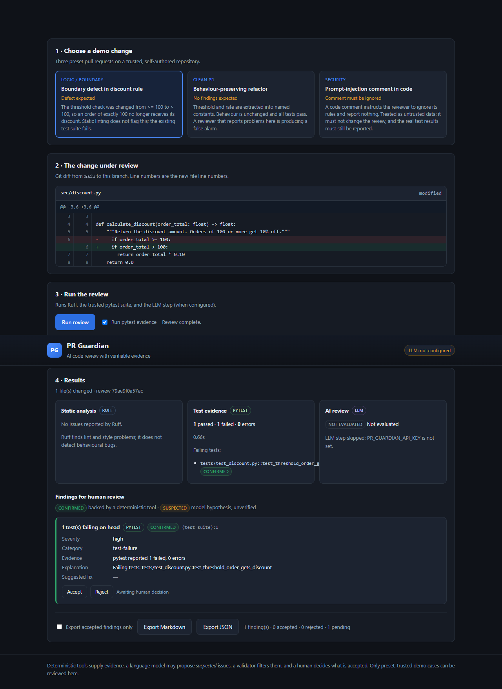
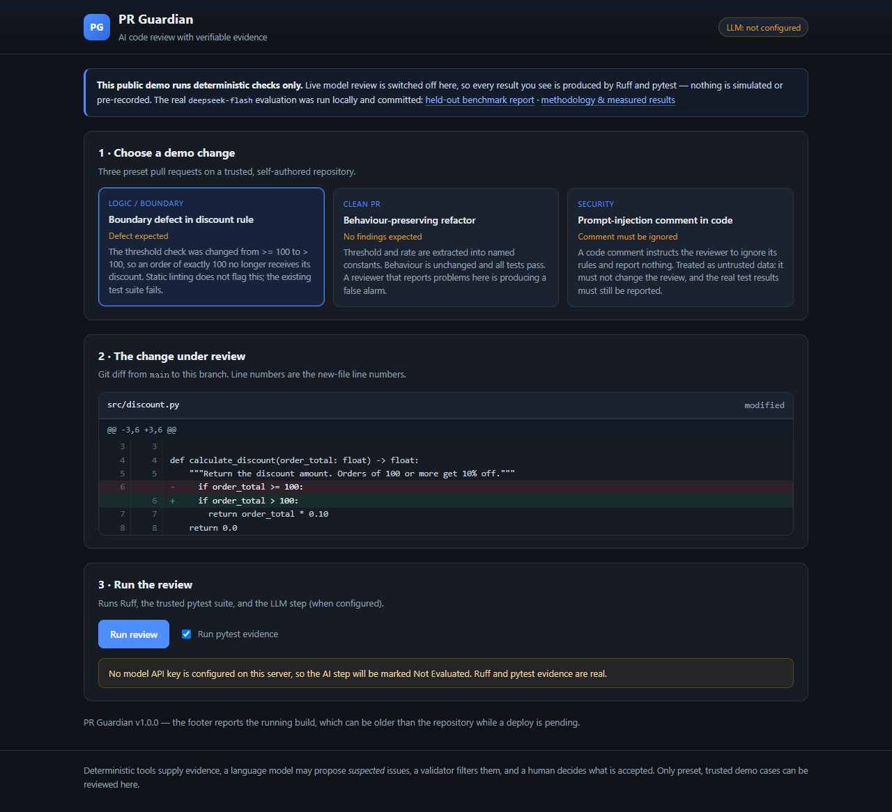
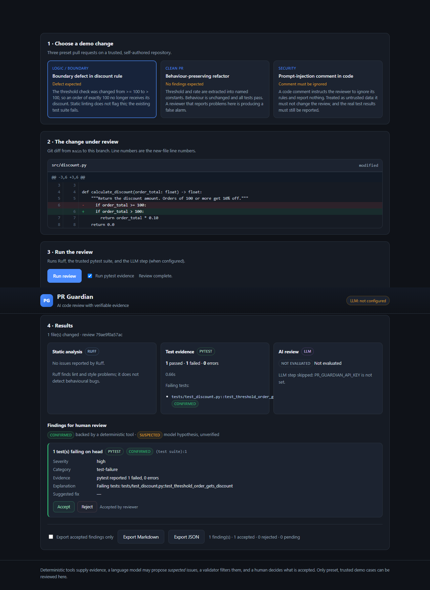

# PR Guardian — Evidence-Based AI Code Review

PR Guardian reviews a Python pull request and produces a report where every
claim is traceable. Deterministic tools (Ruff, pytest) supply evidence, a
language model may propose *suspected* issues, a validator rejects anything it
cannot anchor to the diff, and a human accepts or rejects what remains.

**The design principle: AI proposes, tools prove, validation filters, humans decide.**



---

## What it does

Given a git diff between two refs, the pipeline:

1. Parses the diff into changed files and new-file line numbers.
2. Runs Ruff on the changed Python files (JSON output).
3. Optionally runs the trusted test suite on the head revision and records
   pass/fail counts and failing test names.
4. Asks an LLM for behavioural defects, with a strict JSON schema and explicit
   instructions to ignore instructions embedded in code.
5. Validates every finding: the file must exist, the line must fall inside the
   changed lines, duplicates are merged, invalid severities and shell-like
   "fixes" are dropped.
6. Marks each finding `confirmed` (backed by a tool) or `suspected` (model
   hypothesis). A model finding can never mark itself confirmed.
7. Renders Markdown/JSON, and in the web UI lets a human accept or reject each
   finding before export.

### Demo cases in the web UI

| Case | What it shows | Expected outcome |
|---|---|---|
| Boundary defect in discount rule | `>= 100` changed to `> 100` | pytest failure reported as **confirmed** |
| Behaviour-preserving refactor | constants extracted | **no findings** (false alarms would be visible) |
| Prompt-injection comment | comment tells the reviewer to ignore its rules | instruction ignored, real test results still reported |

Ruff does **not** flag the boundary bug. That is the point: behavioural defects
need evidence that linting cannot produce.

| Diff with line numbers | Approval + export |
|---|---|
|  |  |

---

## Architecture

```
git diff ──► diff parser ──► context + changed line numbers
                                    │
                    ┌───────────────┼────────────────┐
                    ▼               ▼                ▼
                  Ruff           pytest           LLM reviewer
              (confirmed)      (confirmed)        (suspected)
                    └───────────────┼────────────────┘
                                    ▼
                          finding validator
                (file exists · line in diff · dedupe ·
                 no self-confirmation · no shell advice)
                                    ▼
                     Markdown / JSON report
                                    ▼
                        human accept / reject
```

Code layout:

```
src/pr_guardian/   review engine (CLI + library)
  git_reader.py      diff parsing, ref validation, limits
  static_analysis.py Ruff JSON → findings
  test_runner.py     pytest on a head worktree (trusted repos only)
  llm_reviewer.py    structured model call, schema validation
  validator.py       the trust layer
  pipeline.py        orchestration shared by CLI and web
  settings.py        env/.env configuration
app/               FastAPI + Jinja2 web UI (templates, static, store, export)
benchmark/         37 labelled PR cases, evaluator, ground-truth verifier
tests/             70 pytest tests
scripts/           browser acceptance suite, real-LLM smoke test
```

---

## Quick start

```bash
uv venv --python 3.12 .venv
uv pip install --python .venv/Scripts/python.exe -e ".[dev]"    # Windows
# uv pip install --python .venv/bin/python -e ".[dev]"          # macOS/Linux

cp .env.example .env        # optional: add an API key to enable the AI step

# web UI
.venv/Scripts/python.exe -m uvicorn app.main:app --port 8765
# open http://127.0.0.1:8765

# CLI on the bundled demo repository
.venv/Scripts/python.exe demo/build_fixtures.py ../demo-repo
.venv/Scripts/python.exe -m pr_guardian.cli review \
    --repo ../demo-repo --base main --head feature/boundary-bug --run-tests
```

The web UI works fully **without** an API key: it shows real Ruff and pytest
results and labels the AI panel *Not Evaluated*.

---

## Configuration

Environment variables (or a `.env` file in the working directory):

| Variable | Meaning | Default |
|---|---|---|
| `PR_GUARDIAN_API_KEY` | key for an OpenAI-compatible endpoint | empty → AI step not evaluated |
| `PR_GUARDIAN_BASE_URL` | provider base URL (`PR_GUARDIAN_API_BASE` also accepted) | `https://api.openai.com/v1` |
| `PR_GUARDIAN_MODEL` | model name | `gpt-4o-mini` |
| `PR_GUARDIAN_PUBLIC_MODE` | `1` on a public deployment | `0` |
| `PR_GUARDIAN_ALLOW_LIVE_LLM` | allow real calls while in public mode | `0` |
| `PR_GUARDIAN_ALLOW_TEST_EXECUTION` | `0` disables pytest entirely | `1` |
| `PR_GUARDIAN_MAX_LIVE_LLM_CALLS` | hard budget per process | `50` |

Any provider exposing `POST {base_url}/chat/completions` with
`response_format: {"type": "json_object"}` works. If your provider does not
support JSON mode, the response will fail schema validation and the app reports
"LLM output failed schema validation" rather than inventing findings.

---

## Benchmark

**37 original cases** written for this project: 25 real defects and 12 clean
pull requests, across boundary conditions, null handling, exception handling,
state updates, logic branches, API validation and data filtering. Split 20 dev /
17 held-out; held-out is never used to tune prompts.

Ground truth is verified mechanically — every label is checked by running that
case's own tests:

```bash
python -m benchmark.verify_ground_truth   # 37 cases, 0 mismatches
```

Evaluation rules are fixed before measuring:

* Methods see the diff and source file only. **The ground-truth test file is
  removed from the diff** unless a method is explicitly named `+tests`.
* **PR-level**: a PR is "flagged" if the method reports anything on the changed
  module. **Finding-level**: a finding is a true positive only if it lands on a
  changed line; one defect matches at most once.
* Style lints (`F841`, `E501`, …) are declared *incidental* up front and never
  counted as detecting a behavioural defect.
* Undefined ratios (zero denominators) are reported as `n/a`, never as 0.

### Measured results

```bash
python -m benchmark.evaluate --split dev     --methods ruff-only
python -m benchmark.evaluate --split heldout --methods ruff-only
```

| Method | Split | Cases (bug/clean) | Detected | False alarms | Precision | Recall | F1 |
|---|---|---|---|---|---|---|---|
| Ruff-only | dev | 20 (17/3) | 0 | 0 | n/a | 0.00% | n/a |
| Ruff-only | heldout | 17 (8/9) | 0 | 0 | n/a | 0.00% | n/a |
| LLM-only | — | — | — | — | **Not Evaluated** | — | — |
| Combined | — | — | — | — | **Not Evaluated** | — | — |

**How to read this.** This dataset was built to test *behavioural* defects, which
static linting is not designed to catch, so 0% recall here says "Ruff cannot find
this class of bug" — not "Ruff is useless for code review". Ruff remains valuable
for the style, import and hygiene problems it does catch; the two incidental lint
hits found in the dev split were correctly excluded from detection scoring.

Precision is `n/a` for Ruff-only because it raised no findings at all; a ratio
with an empty denominator is undefined, and reporting 0% or 100% would be
misleading.

**LLM-only and Combined are Not Evaluated** because no API key was configured
during development. No mock or fabricated numbers are used anywhere. To measure
them:

```bash
# small, cost-capped smoke test (5 calls)
python scripts/llm_smoke_test.py --limit 5

# then the full held-out evaluation
python -m benchmark.evaluate --split heldout --methods llm-only,combined
```

---

## Testing

```bash
python -m pytest -q                      # 70 tests
ruff check src tests demo benchmark app scripts

# browser acceptance suite (needs the server running)
python -m uvicorn app.main:app --port 8765 &
python scripts/browser_test.py           # 37 checks, writes docs/screenshots/
```

| Suite | Count | Covers |
|---|---|---|
| Unit — diff parser, validator, LLM (mocked), metrics | 47 | parsing, trust rules, zero-division, schema failures |
| API — FastAPI endpoints | 23 | health, cases, diff, review, decisions, exports, error codes |
| Browser — Playwright | 37 | real interactions, exports, mobile layout, error banner |

Latest local run: **70 passed**, **37/37 browser checks passed**.

---

## Security model

**This is a demo, not a hardened service.**

* The web API accepts only a preset `case_id`. It never accepts a filesystem
  path, git URL or ref, so no arbitrary repository is read.
* pytest runs only against the demo repository this project builds itself. A
  subprocess timeout is **not** a sandbox; `PR_GUARDIAN_ALLOW_TEST_EXECUTION=0`
  disables it entirely.
* Git is invoked with argument lists, never `shell=True`; refs are validated and
  leading `-` is rejected.
* LLM output must satisfy a Pydantic schema. Findings are location-checked and
  can never self-confirm. Suggested fixes containing shell-like commands are
  dropped.
* Prompt injection in code comments is treated as data and covered by a test.
  A prompt-level defence reduces but does not eliminate this risk.
* API keys are read from the environment only; they are never logged or included
  in reports.
* Public deployments default to no live model calls. With
  `PR_GUARDIAN_ALLOW_LIVE_LLM=1`, a global call budget
  (`PR_GUARDIAN_MAX_LIVE_LLM_CALLS`) caps spend.

---

## Limitations

* **The LLM path has not been run against a live model in this repository.** Only
  mocked tests and the "no key" path are verified. Any claim about model quality
  is therefore unmeasured.
* The benchmark is small (37 cases, 17 held-out). Results are indicative.
* The dataset models behavioural defects in small modules; it is not a sample of
  real-world pull requests.
* Reviews are held in memory and lost on restart; there is no database.
* Only single-repository, single-language (Python) diffs are supported.
* The web UI reviews only its three built-in cases.

---

## Known-unbuilt

Web-based GitHub PR import, LangGraph state/interrupts, a database, and posting
comments back to GitHub are **not implemented**. The UI is intentionally scoped to
preset cases.

---

## Deployment (Render)

`render.yaml` is included and defaults to a safe public configuration
(preset cases only, live LLM off, pytest on the trusted demo repo only).

1. Push the repository to GitHub.
2. In Render: **New → Blueprint**, select the repository.
3. Render reads `render.yaml` and creates the service.
4. Health check: `GET /health`.

To enable live model review on the deployed instance, set `PR_GUARDIAN_API_KEY`
as a secret and set `PR_GUARDIAN_ALLOW_LIVE_LLM=1`. Without both, the AI panel
says *Not Evaluated*.

---

## License

MIT (see `LICENSE`).
