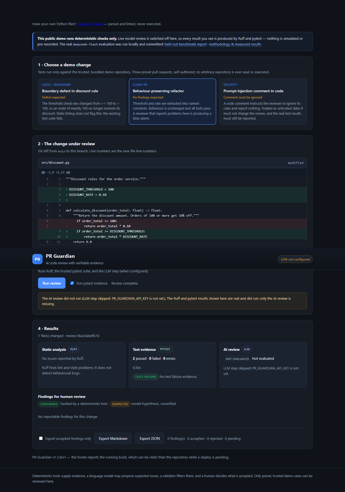
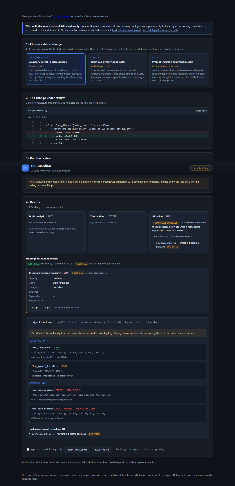

# PR Guardian — Evidence-Based AI Code Review

**v1.1.0rc1** · Python 3.12 · FastAPI · MIT

PR Guardian reviews a Python pull request and returns findings a reviewer can audit:
every AI claim is tied to source lines that were actually delivered to the model, and
every review states whether it finished, ran out of budget, or did not run at all.

Most "AI code review" demos ask a model for an opinion and print it. PR Guardian asks
a different question first — *what evidence does this review actually have?* — and
refuses to dress a partial review up as a clean one.

| | |
|---|---|
| **Public demo** | **https://pr-guardian-ai-uodn.onrender.com** |
| Live model calls there | **off** (`PR_GUARDIAN_ALLOW_LIVE_LLM=0`). It runs the V1 build: Ruff + pytest evidence, no paid AI. |
| Local AI mode | your own DeepSeek (or any OpenAI-compatible) key, see [Run it locally](#run-it-locally) |
| This repository | 1.1.0rc1 (local release candidate) — the footer of any deployment reports its own running version |

> The public instance is **not** running this build. The page footer reports the
> version it actually runs; nothing here claims otherwise.

---

## Contents

1. [The problem](#the-problem)
2. [How it differs from an LLM review demo](#how-it-differs-from-an-llm-review-demo)
3. [Architecture](#architecture)
4. [Stack](#stack)
5. [Screenshots](#screenshots)
6. [Public demo vs local AI mode](#public-demo-vs-local-ai-mode)
7. [Function calling, MCP and BM25](#function-calling-mcp-and-bm25)
8. [Evidence provenance and review completeness](#evidence-provenance-and-review-completeness)
9. [Results, and what they do not say](#results-and-what-they-do-not-say)
10. [Run it locally](#run-it-locally)
11. [Tests, CI and security](#tests-ci-and-security)
12. [Experimental work and negative results](#experimental-work-and-negative-results)

---

## The problem

A diff review has two failure modes that look identical in a chat transcript:

* the model found nothing because the change is fine;
* the model found nothing because it never read the code that mattered.

A review that cannot tell those apart is not evidence. PR Guardian makes the second
case visible: it records what the model was shown, pins every read to one commit,
groups findings by whether their evidence was delivered, and reports the process state
(`completed` / `partial` / `failed` / `not_run` / `unknown`) separately from any defect
verdict.

**The design principle: AI proposes, tools prove, validation filters, humans decide.**

## How it differs from an LLM review demo

| Generic LLM demo | PR Guardian |
|---|---|
| one prompt, free-text answer | structured findings with file, line span and severity |
| "the model says line 42 is wrong" | the cited lines were delivered to the model in this commit, or the claim is marked unverified |
| silent truncation | a citation only counts when every line arrived in full |
| "no issues found" | `partial` / `not_run` are separate states, and partial never means clean |
| no tools | read-only tools (`read_code_context`, `find_symbol_definition`, `search_code`) over a pinned Git snapshot, on a `src/**/*.py` allowlist |
| trust the model's tool use | every tool call is budgeted, recorded and replayable |

## Architecture

```
        ┌──────────────┐   diff + changed files   ┌────────────────────┐
Git ───▶│ GitSnapshot  │─────────────────────────▶│ deterministic pass │
        │ (pinned SHA) │                          │ Ruff · pytest      │
        └──────┬───────┘                          └─────────┬──────────┘
               │ tool payloads (ref = SHA)                   │ findings
               ▼                                             ▼
        ┌──────────────┐   tool_calls   ┌──────────────┐  ┌──────────────┐
        │ read-only    │◀──────────────▶│ model loop   │─▶│ Evidence     │
        │ tools / MCP  │  tool results  │ (DeepSeek)   │  │ Registry     │
        └──────────────┘                └──────────────┘  └──────┬───────┘
               │ BM25 index over src/**/*.py                      │
               ▼                                                  ▼
        ┌──────────────┐                                  ┌────────────────┐
        │ search_code  │                                  │ verify citations│
        └──────────────┘                                  │ completeness    │
                                                          └────────┬───────┘
                                                                   ▼
                                                     ReviewReport → API · UI · export
```

Key invariants:

* every tool read is served from **one commit**, and every payload carries that SHA;
* the model can only read `src/**/*.py` — tests, docs, `.env`, symlinks and paths
  outside `src/` are refused;
* search hits are **candidates**, never evidence;
* a finding whose citation is not fully delivered is kept, but marked unverified.

## Stack

Python 3.12 · FastAPI · Jinja2 + vanilla JS · Pydantic v2 · httpx · Ruff · pytest ·
BM25 (own implementation, no embedding model) · MCP Python SDK 2.3.0 (stdio) ·
Playwright (UI checks) · GitHub Actions · Render (free tier).

## Screenshots

| Diff view | Findings with evidence badges |
|---|---|
|  |  |

| Clean PR wording | Tool trace |
|---|---|
|  |  |

More in [`docs/screenshots/`](docs/screenshots).

## Public demo vs local AI mode

| | Public demo | Local AI mode |
|---|---|---|
| URL / command | https://pr-guardian-ai-uodn.onrender.com | `uvicorn app.main:app` on your machine |
| Runs Ruff + pytest | yes | yes |
| Calls a paid model | **no** (`ALLOW_LIVE_LLM=0`) | yes, with **your** key |
| AI panel | "Not Evaluated" — honest, not an error | real findings, with evidence status |
| Which repo can be reviewed | the three preset demo cases only | the same preset demo cases (this build does not accept arbitrary repositories) |

The public instance is deliberately boring: it can review only the self-authored demo
cases, it never spends money, and it says "Not Evaluated" rather than inventing an AI
answer.

## Upload your own code (V1.1, off by default)

A separate page at `/upload` accepts `.py` files or a ZIP and analyses them **without
executing anything**: AST parse, a short list of explainable patterns, and Ruff. Every
finding maps to a file and line; heuristic findings are marked `suspected`; exports and
accept/reject work as in the demo. Uploads are disabled unless
`PR_GUARDIAN_UPLOAD_ENABLED=1`, and a public instance needs a second acknowledgement
(`PR_GUARDIAN_UPLOAD_PUBLIC=1`).

Fastest path — a launcher that binds `127.0.0.1` only, enables local uploads, keeps AI
off, and asks before installing anything:

```bash
./start-local.sh          # macOS / Linux
start-local.bat           # Windows
# both open http://127.0.0.1:8000
```

Or start it yourself:

```bash
PR_GUARDIAN_UPLOAD_ENABLED=1 uvicorn app.main:app --host 127.0.0.1 --port 8000
# then open http://127.0.0.1:8000/upload
```

Step-by-step instructions, including how to read a finding and how to stop the server:
[`docs/release-1.1/USER_GUIDE.md`](docs/release-1.1/USER_GUIDE.md).

A public instance needs the second acknowledgement (`PR_GUARDIAN_UPLOAD_PUBLIC=1`) and is
still **not recommended** — see the release notes. Read the boundary before enabling it
anywhere: [`docs/v1.1-upload-review.md`](docs/v1.1-upload-review.md) and
[`docs/release-1.1/RELEASE_NOTES.md`](docs/release-1.1/RELEASE_NOTES.md).

| Empty state | Findings |
|---|---|
|  |  |

## Function calling, MCP and BM25

**Function calling** (`PR_GUARDIAN_TOOL_CALLS_ENABLED=1`, default off) lets the model
ask for evidence instead of guessing:

* `read_code_context(file, start, end)` — numbered lines from the snapshot;
* `find_symbol_definition(symbol)` — the definition that matters;
* `search_code(query, top_k)` — BM25 over `src/**/*.py`.

Calls are budgeted (`MAX_TOOL_ROUNDS`, `MAX_TOOL_CALLS`) and every call is recorded in
`ReviewReport.tool_calls` with its outcome (`hit`, `miss`, `error`, `budget_denied`).

**MCP** (`PR_GUARDIAN_TOOL_BACKEND=mcp`) exposes the same three tools over a local
stdio MCP server, with a whitelisted child environment (the API key is not passed to
it). Local and MCP backends return byte-identical payloads — covered by tests.

**BM25** indexes `src/**/*.py` at the pinned commit, cached by SHA and verified on
reuse. No embedding model, no vector database: retrieval is deterministic, inspectable
and cheap. A dense/hybrid experiment was run and **rejected** — see [negative
results](#experimental-work-and-negative-results).

## Evidence provenance and review completeness

**Provenance (V4.1).** Each AI finding carries `evidence_refs`. A ref is verified only
when the file is in the allowlist, the range lies inside lines that arrived in full,
the SHA matches the registry, and the delivering tool call exists. Verified findings
are **`suspected`** with **`claim_unjudged`** — delivered evidence, not a proven
defect. Findings with no verifiable citation stay visible and marked unverified.

**Completeness (V4.2).** Every report states what the process actually did:

| `review_status` | Meaning |
|---|---|
| `completed` | the review ran to the end of its plan |
| `partial` | stopped early — tool budget exhausted or round limit reached; findings shown are incomplete coverage |
| `failed` | the model call failed |
| `not_run` | AI disabled or not configured; Ruff/pytest results are still real |
| `unknown` | historical report without execution records |

Call counts are kept separate: requested / executed / denied / errored. "partial" is
never rendered as "clean".

## Results, and what they do not say

All numbers below come from **self-authored synthetic repositories**. They measure
whether the pipeline works, not how it performs on real code review.

| Method | Split | Cases | TP | FP | FN | Precision | Recall | F1 | Clean false alarm |
|---|---|---|---|---|---|---|---|---|---|
| Ruff-only | held-out | 17 (8/9) | 0 | 0 | 8 | n/a | 0 % | n/a | 0 % |
| LLM-only | held-out | 17 (8/9) | 7 | 1 | 1 | 87.50 % | 87.50 % | 87.50 % | 11.11 % |
| Combined | held-out | 17 (8/9) | 8 | 1 | 0 | 88.89 % | 100 % | 94.12 % | 11.11 % |

Read this as: *on 17 synthetic held-out cases, the combined pipeline caught 8 of 8
seeded defects and raised one false alarm on 9 clean cases.* With n = 17 that is a
smoke signal; it is **not** production accuracy, and it must not be quoted as such.

Other measured results, including the negative ones:

* BM25 retrieval: hit-rate study on 103 chunks / 51 frozen queries — a small-corpus
  measurement, not a general retrieval claim;
* dense + RRF hybrid: **No-Go**, archived with its evaluation;
* exact-repeat tool cache: **No-Go** — 0 repeats in 37 real recorded calls;
* evidence-first planner: **No-Go** — fewer calls, but one required evidence range was
  lost, which fails the "no weaker proof" rule;
* offline evidence-sufficiency gate: research prototype, not wired into the product.

## Run it locally

```bash
git clone https://github.com/Ddoreamon/pr-guardian-ai
cd pr-guardian-ai
python -m venv .venv && . .venv/Scripts/activate    # Linux/macOS: source .venv/bin/activate
pip install -e ".[dev]"
cp .env.example .env                                # optional: add your key for AI review
uvicorn app.main:app --port 8000
```

Open http://127.0.0.1:8000, pick a demo case, review it.

For real AI review, set in `.env` (never commit it):

```bash
PR_GUARDIAN_API_KEY=<your-key>        # your key, never committed
PR_GUARDIAN_BASE_URL=https://api.deepseek.com
PR_GUARDIAN_MODEL=deepseek-chat
PR_GUARDIAN_ALLOW_LIVE_LLM=1
PR_GUARDIAN_TOOL_CALLS_ENABLED=1      # optional: function calling
```

Without a key the app still works: Ruff and pytest evidence stay real and the AI panel
says "Not Evaluated".

## Tests, CI and security

```bash
pytest -q                                        # unit, API, MCP, evidence, version
ruff check src tests demo benchmark app scripts
python scripts/browser_test.py --base-url http://127.0.0.1:8000   # 76 UI checks
```

* CI: lint + tests, and a Playwright browser job on every push and PR.
* Security: the API key never reaches logs, reports, exports or the MCP child process;
  tool reads are allowlisted and SHA-pinned; the public deployment runs with live
  model calls off; exports contain no host paths or credentials.
* Reports and exports are plain JSON/Markdown; no database, no background jobs.

## Experimental work and negative results

Kept in the repository on purpose — a review tool that hides its failed experiments is
not auditable.

| Work | Outcome | Document |
|---|---|---|
| Dense retrieval + RRF hybrid | No-Go, excluded from the product | `feature/v3-hybrid-rag` (branch), `docs/rag-stage-v2.md` |
| Exact-repeat tool cache | No-Go: 0 exact repeats in 37 calls | [`docs/v4.3-budget-efficiency.md`](docs/v4.3-budget-efficiency.md) |
| Evidence-first planner prompt | No-Go: lost a required evidence range | [`docs/v4.4-comparison.md`](docs/v4.4-comparison.md) |
| Evidence sufficiency gate | research prototype, offline only | [`docs/v4.5-decision.md`](docs/v4.5-decision.md) |
| Shadow replay | offline script, not in the review path | [`docs/v4.5-shadow-mode.md`](docs/v4.5-shadow-mode.md) |

Release audit and integration plan: [`docs/release-1.0/`](docs/release-1.0).

## License

MIT (see `LICENSE`).
