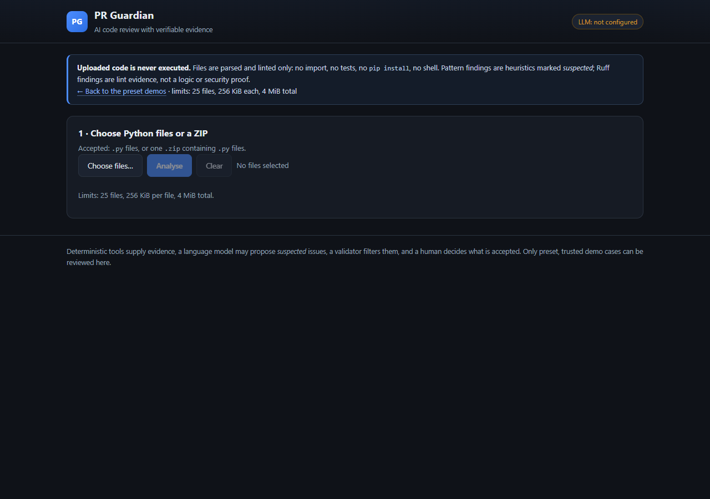
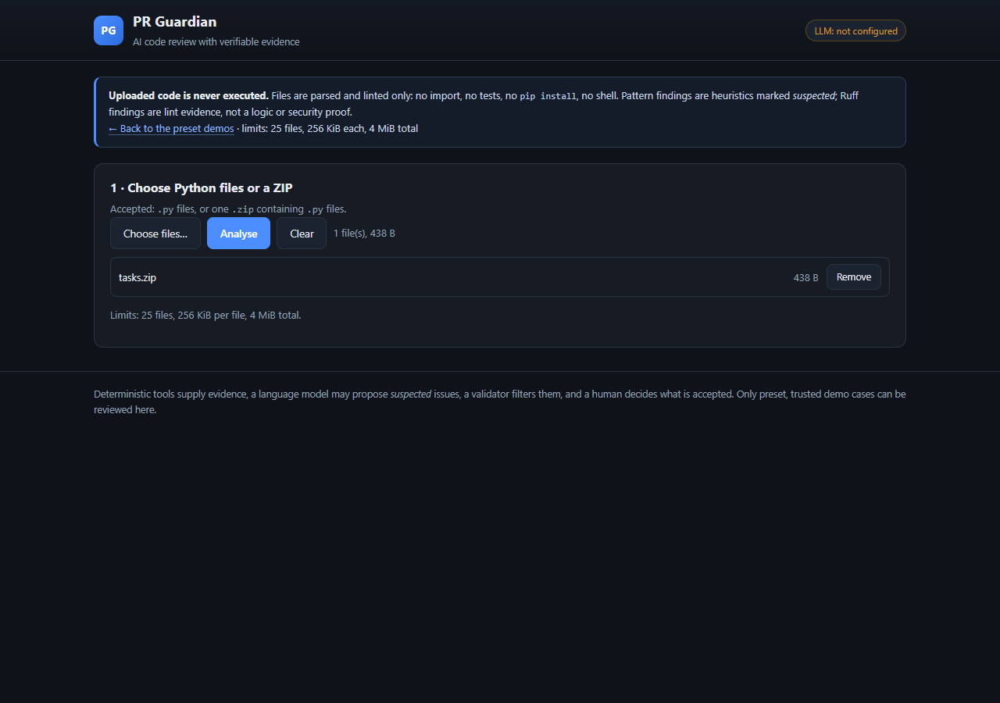
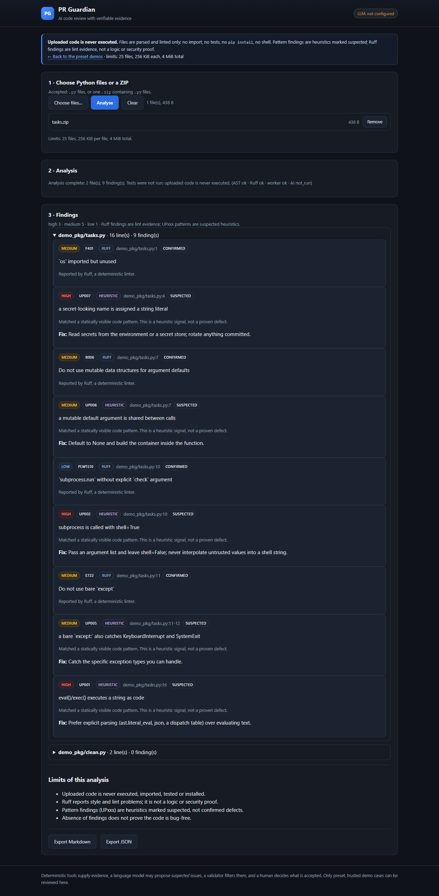

# PR Guardian V1.1 — Upload & review

Real users can review their own Python code without handing it to a model to execute.
Uploaded code is **parsed and linted, never run**.

Status: feature branch `feature/v1.1-upload-review`, **not deployed**. Uploads are off by
default; a public instance needs a second explicit acknowledgement.

---

## 1. Why this exists and what it refuses to do

The demo reviews three preset pull requests. That proves the pipeline but not the
product. V1.1 adds a separate page where a user uploads `.py` files or a ZIP and gets a
report they can read, approve and export.

The product value is bounded on purpose:

| It does | It does **not** do |
|---|---|
| parses each file with the Python AST | import or execute the uploaded code |
| runs Ruff over a temporary copy | run pytest on the uploaded code |
| flags a short list of explainable patterns (`UP001`–`UP007`) | claim to find logic bugs |
| maps every finding to a file and line | install dependencies from the upload |
| exports JSON and Markdown, with accept/reject | send a finding as `confirmed` unless a deterministic tool produced it |

**No issues detected by the enabled checks. This does not prove the code is bug-free.**
That sentence is what the page shows when a review is clean, and the report notes say the
same thing.

## 2. Architecture

```
browser ──POST /api/uploads──▶ app/uploads_api.py
                                 │  validate (uploads.py): names, types, sizes, ratios,
                                 │  duplicates, symlinks, encodings
                                 ▼
                          temp dir (0700, unique, removed in finally)
                                 │  written with safe_target(); no path escapes it
                                 ▼
                python -I -m pr_guardian.upload_worker <dir>   (subprocess, hard timeout)
                                 │   ast.parse each file
                                 │   UP001-UP007 heuristics
                                 │   ruff check --isolated (static, no execution)
                                 ▼
                          JSON {files, findings, ruff_status}
                                 │
                                 ▼
                     ReviewReport  (same model as the demo flow)
                                 │
              store ──▶ /api/reviews/{id} · /export (JSON, Markdown) · accept/reject
```

Reusing `ReviewReport` is deliberate: retrieval, approvals, exports and the existing
browser tests keep working, and an upload can never borrow the demo's trusted-test
privilege because `test_summary.ran` is always `False` with an explicit reason.

## 3. Security boundary

Every upload is treated as hostile input.

| Threat | Control |
|---|---|
| executing user code | the only processes are the analyser worker and Ruff; neither imports or runs the files. A test uploads a file that would create a marker if executed and asserts the marker never appears |
| `pip install` of user deps | no package manager is invoked; the worker gets `env={"PATH": "", "PYTHONPATH": ""}` |
| Zip Slip (`../`, absolute paths) | `_normalise_name` rejects traversal and absolute/drive paths; `safe_target` re-checks the resolved path stays under the work dir |
| symlink entries | ZIP entries with `S_IFLNK` are refused |
| ZIP bomb | per-file 256 KiB, total 4 MiB, archive 8 MiB, compression ratio ≤ 100, ≤ 25 files |
| duplicate / case-collision | case-insensitive duplicate check after NFC normalisation |
| encoding tricks | UTF-8 only; a decode failure is a user-facing rejection |
| path traversal through the API | the endpoint accepts no path parameter, only uploaded file parts |
| runaway analysis | hard wall-clock timeout (20 s + 5 s grace) on the worker subprocess; findings capped at 500 |
| reading server files | the worker is rooted at the temp dir; it never receives a path from the client |
| prompt injection in source | the optional AI pass wraps code in `<<<UNTRUSTED FILE …>>>` blocks and tells the model to ignore instructions inside them; no tool or shell is exposed to the model |
| model cost | uploads call no model by default; `UPLOAD_AI=1` allows one budgeted call, and public mode refuses regardless |
| secret leakage | nothing is logged with source text; the worker writes no files; reports contain only paths relative to the upload |

Residual risks, stated plainly:

* this is **process isolation, not an OS sandbox**: the worker shares the host kernel and
  filesystem permissions. Without a container/seccomp layer, the control is "we never
  execute user code", plus resource limits.
* Ruff parses hostile syntax. A parser bug is a theoretical attack surface; the mitigations
  are the pinned Ruff version, the size limits and the timeout.
* memory is bounded by input size, not by an RSS cap; a 4 MiB upload of pathological syntax
  can still consume CPU until the timeout fires.

## 4. Limits (enforced server-side, shown in the UI)

| Limit | Value |
|---|---|
| files per upload | 25 |
| bytes per file | 256 KiB |
| bytes total (uncompressed) | 4 MiB |
| archive size | 8 MiB |
| compression ratio | 100 |
| analysis time | 20 s (+5 s grace) |
| findings in a report | 500 |

## 5. Findings model

| Source | Verification | Meaning |
|---|---|---|
| `ruff` | `confirmed` | a deterministic linter reported it |
| `heuristic` (`UP001`–`UP007`) | `suspected` | a statically visible pattern; not a proven defect |
| `syntax` (`AST001`) | `suspected` | the file could not be parsed, so nothing else ran on it |
| `llm` (opt-in) | `suspected` | citations are validated against the upload; never promoted |

Rules: `UP001` eval/exec, `UP002` `shell=True`, `UP003` `os.system`/`os.popen`,
`UP004` `pickle.loads`/unsafe `yaml.load`, `UP005` bare `except`, `UP006` mutable default,
`UP007` secret-looking assignment. Each carries a suggestion; the list is intentionally
short and explainable.

## 6. Hardening (review follow-up)

### 6.1 The analyser no longer blocks the event loop

`POST /api/uploads` is `async`, but the analysis runs in a **worker thread**
(`anyio.to_thread.run_sync`), so `/health`, the demo API and other requests keep
answering while a worker is busy. A module-level slot counter bounds concurrency
(`PR_GUARDIAN_UPLOAD_CONCURRENCY`, default 2, max 4):

* a public instance refuses uploads unconditionally (`public_mode` wins over every flag);
* a free slot is taken before any process starts, so N concurrent uploads cannot spawn
  more than N analyser processes;
* when all slots are taken the request gets **503 + `Retry-After: 2`** with
  `{"error": "busy"}` instead of queueing without bound;
* the slot is released in a `finally` on every path (success, rejection, timeout,
  unexpected error) — a leaked slot would otherwise permanently reduce capacity.

Evidence: `tests/test_upload_hardening.py` holds a slow analysis while asserting
`/health` and `/api/cases` answer in under 2 s, asserts the 503 + `Retry-After` when the
single slot is taken, and asserts the slot is free again after a timeout. The acceptance
run shows `codes=[201, 201, 503, 503]`, `/health` 200 in 0.2 s.

### 6.2 Analysis status is explicit, never a blanket "completed"

`ReviewReport.upload_analysis` is additive (default `None`, so pre-V1.1 reports parse):

| Field | Values |
|---|---|
| `ast_status` | `ok` / `partial` (some files unparsable) / `failed` (none parsed) |
| `ruff_status` | `ok` / `empty` / `timeout` / `error` / `unavailable` |
| `worker_status` | `ok` / `timeout` / `error` |
| `ai_status` | `not_run` / `ok` / `failed` / `disabled_by_public_policy` / `budget_exhausted` |

If any stage is degraded, `review_status` becomes **`partial`** with
`completeness.reason = "partial_analysis"` and `findings_signal = "not_evaluated"` when
there are no findings. **Findings already produced are kept** — a Ruff timeout does not
erase heuristic findings, and a syntax error in one file does not hide the others. The
page prints the four stage states in the status line and shows an explicit
"Analysis incomplete … coverage is incomplete; this is not a clean result" banner.

### 6.3 Process tree is killed, not just the direct child

`kill_process_tree` uses the platform primitive that reaches children:

* POSIX: the worker starts with `start_new_session=True`, then `os.killpg(SIGKILL)`;
* Windows: `taskkill /T /F /PID` (a plain `proc.kill()` would leave Ruff running until
  its own 8 s timeout).

The worker also runs Ruff with its own timeout, so the worst case is bounded twice.
Tests spawn a real grandchild process and assert it is gone after the kill; the POSIX
variant runs on Linux CI. **If a platform could not guarantee this, uploads would be
disabled there** — the Windows path is exercised by the suite, so both platforms are
covered.

### 6.4 What is still not proven

Killing a process tree is not a sandbox. The worker still shares the host kernel, the
filesystem permissions of the service user and its memory budget. Nothing here justifies
running uploads on a shared public instance without the controls in §8.

## 7. Configuration

| Variable | Default | Effect |
|---|---|---|
| `PR_GUARDIAN_UPLOAD_ENABLED` | `0` | expose `/upload` and `/api/uploads` |
| `PR_GUARDIAN_UPLOAD_PUBLIC` | `0` | legacy flag, retained for compatibility; public mode refuses uploads regardless |
| `PR_GUARDIAN_UPLOAD_AI` | `0` | optional one-call AI pass; never in public mode |

Local use:

```bash
PR_GUARDIAN_UPLOAD_ENABLED=1 uvicorn app.main:app --port 8000
# open http://127.0.0.1:8000/upload
```

## 8. Test evidence

`tests/test_uploads.py` — 34 tests and `tests/test_upload_hardening.py` — 12 tests, no
network, no model:

valid single/multi file, valid ZIP, invalid type, Zip Slip, ZIP bomb, absolute path,
symlink entry, duplicate and case-colliding names, Unicode names, syntax error, oversized
file, bad encoding, empty upload, timeout, concurrency (4 parallel uploads), "uploaded code
is never executed" (marker file), "only the worker and Ruff are spawned", work dir removed,
public mode never calls a paid model, AI off by default, budget exhaustion, HTTP round
trip, JSON/Markdown export, approval, demo regression, disabled-by-default, public
acknowledgement, page states the boundary.

Hardening tests: busy response and `Retry-After`, health/demo responsiveness during a
slow analysis, slot released after a timeout, 413 for an oversized body, partial status
with findings preserved on a Ruff timeout, partial/failed AST with Ruff findings kept, AI
`not_run`, Windows/POSIX grandchild kill, no source text in logs, no source text in the
report JSON.

Full suite on this branch: **453 passed, 1 skipped** (the POSIX-only tree test on
Windows); Ruff clean; existing browser suite **77/77** with uploads both off and on; the
ten-item acceptance script passes **11/11** checks.

## 9. Go / No-Go for public deployment

| Question | Answer |
|---|---|
| Is the upload path safe to run locally / self-hosted? | **GO.** No execution, bounded resources, timeout, path confinement, 34 tests. |
| Is it safe to enable on the public Render demo? | **NO-GO (unchanged).** Concurrency is now bounded and the event loop no longer blocks, but the instance still has no OS-level sandbox, no per-IP rate limit and no memory cap per worker; one 4 MiB pathological upload can still take a 512 MB free instance down. Uploads stay default-off. |
| Does it break existing behaviour? | No: demo page, API, approvals, exports and browser checks unchanged; `/upload` is additive. |

Recommended before public enablement:

1. run the analyser in a container or a subprocess with an RSS/CPU cap (e.g. `resource` on
   Linux, Job Object on Windows);
2. add a per-IP rate limit and a queue with a bounded worker count;
3. add an egress firewall rule for the analyser process (it needs none);
4. re-run the upload suite plus a fuzz pass over `uploads.py`.

## 10. Resource and abuse audit (public deployment)

| Surface | Current behaviour | Gap for public |
|---|---|---|
| multipart parsing | Starlette streams parts to disk above ~1 MB; our middleware rejects a declared `Content-Length` over 13 MiB with 413 before parsing | chunked uploads without `Content-Length` still reach the parser; a reverse-proxy body limit is required |
| memory before validation | one file part is read in 64 KiB chunks up to its cap; at most 4 MiB of file data plus the parsed form | multipart for 25 files can transiently hold several copies; acceptable locally, untested on 512 MB |
| ZIP peak | archive cap 8 MiB, expansion cap 4 MiB, per-file 256 KiB, ratio ≤ 100, entry count ≤ 100 | deflate CPU is bounded by the timeout, not by a CPU quota |
| worker memory/CPU | separate `-I` process, 20 s timeout, findings capped at 500 | no RSS cap and no CPU quota; a malicious AST can occupy one core until timeout |
| worker concurrency | slot counter, default 2, 503 above it | per-IP fairness is absent: one client can hold both slots |
| temp dirs | unique dir per request, removed in `finally` | a hard kill (SIGKILL of the server) can leave a directory behind; needs a startup sweep |
| unauthenticated repeats | no auth, no rate limit | one client can queue 503s indefinitely and fill the review store |
| report retention | last 100 reviews in memory (`ReviewStore`), no source text, no evidence sources; process restart clears it | retention is unbounded in time (until eviction) but bounded in count and size |
| logs | no source text, filenames or model output are logged; only uvicorn access lines (method + path) | access logs record the path only, never the body |

These are the reasons the public decision stays **No-Go**: bounded concurrency fixes
self-DoS from a single request, not abuse by a determined client.

## 11. Screenshots

| Empty state | Selected files | Findings |
|---|---|---|
|  |  |  |
